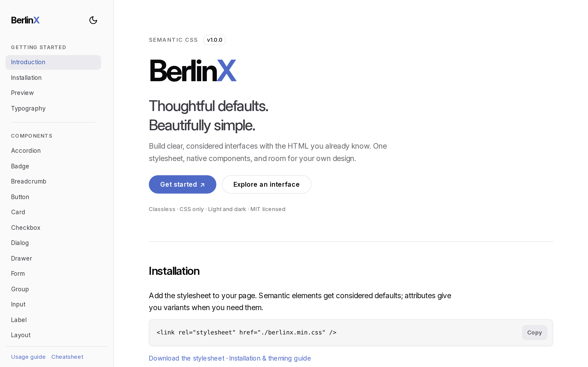

<div align="center">


# BerlinX

**Thoughtful defaults. Beautifully simple.**

A tiny, classless CSS library. Write plain semantic HTML; reach for an attribute
when you want a variant. No classes, no build step, no JavaScript.

[](LICENSE)


[**Live demo**](https://berlinx.southernutahsoftware.com) ·
[Usage guide](https://berlinx.southernutahsoftware.com/guide) ·
[Cheatsheet](https://berlinx.southernutahsoftware.com/cheatsheet)

<br />

<picture>
  <source media="(prefers-color-scheme: dark)" srcset="docs/screenshot-dark.png" />
  
</picture>

</div>

## Why BerlinX?

- **Just HTML.** `<button>`, `<dialog>`, `<details>`, `<table>` look good out
  of the box.
- **Attributes, not classes.** `<button destructive>` reads like what it is.
- **Light and dark.** Follows the system, or pin a theme on any element.
- **Accessible by default.** Every colour pairing meets WCAG AA, focus is
  always visible, and reduced motion is respected.
- **Yours to theme.** A handful of custom properties, and zero-specificity
  base rules so your CSS always wins.

## Get started

Drop the stylesheet into your page:

```html
<link rel="stylesheet" href="https://cdn.jsdelivr.net/npm/berlinx@1.0.0/dist/berlinx.min.css" />
```

or install it:

```sh
npm install berlinx
```

```css
@import "berlinx/min";
```

Prefer to self-host? Download [`dist/berlinx.min.css`](dist/berlinx.min.css).

## A taste

```html
<header row justify="between" items="center">
  <nav breadcrumb><a href="/">Home</a><a href="/docs">Docs</a></nav>
  <button primary>Save</button>
</header>

<article>
  <h2>Invoice #1024</h2>
  <p>Due Friday. <span badge destructive>Overdue</span></p>
  <footer row gap-m justify="end">
    <button secondary>Cancel</button>
    <button destructive>Delete</button>
  </footer>
</article>
```

## Elements, when you need them

HTML has no element for a combobox, a data table or a date picker, so BerlinX
Elements adds them as optional custom elements. They render in the light DOM and
are styled by the same stylesheet, so they match everything else and take your
theme with no extra work. Each wraps native markup that still works without
JavaScript.

```js
import "berlinx/elements";
import { toast, confirm } from "berlinx/elements";
```

```html
<bx-data-table sortable filter page-size="10">
  <table>…</table>
</bx-data-table>
```

Combobox, dropdown menu, context menu, data table, date picker, toasts and a
confirm dialog: about 12 KB gzipped together. See the
[Elements guide](docs/elements.md).

## Make it yours


```css
:root {
  --primary: #7c3aed;
  --radius: 12px;
}
```

## Learn more

- [**Usage guide**](docs/guide.md): installation, layout, components and theming.
- [**Elements**](docs/elements.md): the optional custom elements.
- [**Cheatsheet**](docs/cheatsheet.md): every attribute and token on one page.
- [**Live demo**](https://berlinx.southernutahsoftware.com): every component, in
  light and dark.

## Development

```sh
npm install
npm run build    # dist/ stylesheets, elements and the HTML guides
npm test         # element tests in Chromium, Firefox and WebKit
```

Edit `css/berlinx.css` and `elements/`; `dist/` is generated from them. Open
`index.html` to see the demo, no server needed.

## Thanks

Inspired by [shadcn/ui](https://ui.shadcn.com/) and [Pico](https://picocss.com).
Demo icons by [Lucide](https://lucide.dev).

## License

[MIT](LICENSE) © Southern Utah Software
